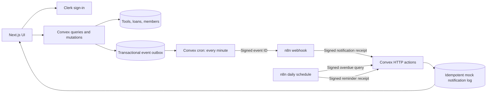

# LendLoop

Borrow what you need. Lend what you don’t.

A neighborhood tool library built with Next.js App Router, TypeScript, Clerk, Convex and n8n. Members list tools, request dates, approve loans and record returns. Administrators can remove listings, review all loans and award Trusted Lender badges.

## Run locally

Requires Node.js 22 and npm. Docker Desktop is needed only for local n8n.

```sh
npm ci
node scripts/setup-local.mjs
npm run dev
```

Open **http://localhost:3100**. Without Clerk and Convex keys, the home page explains what is missing. **/demo** is an interactive, in-memory preview with three sample personas. It uses the same dashboard components as the connected app, but has no authentication, persistent storage or background delivery. Refreshing resets it. It is not a substitute for integration testing.

Port 3100 avoids the job tracker already running on port 3000. On Windows, double-click `Start-LendLoop.cmd`.

### 1. Clerk

Create a development application in [Clerk](https://dashboard.clerk.com). Enable the **Convex integration** (the JWT template must be named `convex`). Copy the publishable and secret keys to `.env.local`.

```dotenv
NEXT_PUBLIC_CLERK_PUBLISHABLE_KEY=...
CLERK_SECRET_KEY=...
```

Keep email/password sign-in enabled for the two-account acceptance test. Copy the application's issuer URL for the next step. See the [official integration guide](https://docs.convex.dev/auth/clerk).

### 2. Convex

```sh
npx convex dev
```

Create/select a development project. The CLI writes `CONVEX_DEPLOYMENT` and `NEXT_PUBLIC_CONVEX_URL` to `.env.local`. Set these **server-side variables in the Convex dashboard**:

| Variable                  | Purpose                                                            |
| ------------------------- | ------------------------------------------------------------------ |
| `CLERK_JWT_ISSUER_DOMAIN` | Clerk Frontend API/issuer URL, including https://                  |
| `ADMIN_SUBJECTS`          | Comma-separated Clerk user IDs allowed to administer LendLoop      |
| `N8N_WEBHOOK_URL`         | Public HTTPS production webhook ending in /webhook/lendloop-events |
| `CONVEX_TO_N8N_SECRET`    | Signing key for event delivery                                     |
| `N8N_TO_CONVEX_SECRET`    | A different key for callbacks and overdue queries                  |

Set the Clerk issuer before the first successful deployment; an auth configuration error is expected if it is absent. Keep `convex dev` running while editing backend functions. It regenerates `convex/_generated`; initial offline bindings are included so tests and builds don't require an account.

There is no public “make me admin” mutation. Add your Clerk user ID to the server environment, then refresh. Ordinary users get no special privileges from editable profile metadata or a role sent by the browser.

### 3. n8n

`setup-local.mjs` creates `.env.n8n` with three independent random secrets. It never prints them and never overwrites an existing file. Set:

| .env.n8n variable      | Value                                                                                     |
| ---------------------- | ----------------------------------------------------------------------------------------- |
| `CONVEX_SITE_URL`      | Your HTTP action URL: https://your-deployment.convex.site (not .cloud; no trailing slash) |
| `N8N_PUBLIC_URL`       | Public HTTPS base URL for n8n, with a trailing slash                                      |
| `CONVEX_TO_N8N_SECRET` | Same value as the corresponding Convex server variable                                    |
| `N8N_TO_CONVEX_SECRET` | Same value as the corresponding Convex server variable                                    |
| `N8N_ENCRYPTION_KEY`   | Persisted n8n encryption key; do not rotate casually                                      |

```sh
docker compose --env-file .env.n8n up -d
```

Open **http://localhost:5678**, create the n8n owner account, and import the JSON files in `n8n/workflows/`:

1. `workflow-errors.json`
2. `request-notifications.json`
3. `overdue-reminders.json`

In the settings of each main workflow, choose **LendLoop — workflow failures** as its error workflow. Workflow IDs belong to your installation, so the exported files deliberately do not hard-code them. Save and publish/activate both main workflows. Use the production webhook URL; the test webhook path is intentionally not accepted by the signature verifier.

Convex Cloud cannot reach your localhost. Use a hosted n8n instance or a controlled HTTPS tunnel/reverse proxy that exposes **only /webhook/** to the internet. Keep the n8n editor private. Set the resulting event URL in Convex. Don't put an access-login page in front of the webhook: the request is authenticated with HMAC.

The supplied Docker profile binds the editor to 127.0.0.1, uses internal task runners, allows only the crypto built-in module and retains executions for seven days. It is a **local development profile**, not a hardened internet deployment. n8n Cloud is not the drop-in target for these environment-backed Code nodes; use the documented self-hosted setup.

### 4. First real loan

Sign in as two different users (two browser profiles work well). The first lists a tool. The second requests dates. The owner approves it, and either participant records its return after the loan has started. The delivery worker runs every minute; expand **Automation activity** on a loan to see notification delivery. Admins can retry failed event deliveries.

The implementation uses the assignment's allowed **logged mock notification** channel. A workflow records a notification in Convex instead of sending email. The notification row and delivery receipt are written in the same transaction. No email account is required, and the interface labels the result as a mock notification.

## Check the implementation

```sh
npm run typecheck
npm test
npm run build
npx playwright install chromium
npm run test:e2e
```

The unit/integration suite executes Convex functions through `convex-test`, including authorization, loan transitions, HTTP authentication, retries and idempotency. Workflow code tests exercise the exact JavaScript exported to n8n. Browser tests exercise the demo and layout; they do not pretend to test Clerk or a deployed Convex database. See [acceptance checks](docs/ACCEPTANCE.md) for the real two-account run.

After changing `n8n/code/`, run `npm run workflows` and re-import the corresponding workflow. CI checks that the generated JSON matches its source.

## Architecture



- `convex/tools.ts`, `loans.ts`, `members.ts`: application permissions and business rules.
- `convex/automation.ts`, `delivery.ts`, `http.ts`: delivery state, HMAC boundary and reminder writes.
- `components/dashboard.tsx`: shared connected/demo interface.
- `components/live-app.tsx`: Clerk + Convex subscriptions.
- `components/demo-app.tsx`: explicitly disposable sample state.
- `n8n/code/`: readable source for the exported Code nodes.

Convex mutations make a state change and insert its outbox event atomically. A minute-based worker leases up to 20 events, signs each request and sends it to n8n. Retries use increasing delays and stop after five unsuccessful attempts. Failed events appear in the admin view. A webhook 200 without a persisted receipt does not count as a delivered notification.

The daily n8n workflow reads overdue loans, processes each item and writes a reminder. HTTP nodes retry three times; remaining failures are retained as failed executions and routed to the error workflow. A manual trigger permits rerunning a failed batch: completed loans are excluded from the next fetch.

## Security and data boundaries

- Public queries return **only name and category**, filtered to tools available today. Descriptions, owner names, IDs and reservation dates require authentication.
- Every private Convex function checks the signed Clerk identity and ownership or administrator status. Hiding a button is not an authorization control.
- Date ranges are inclusive UTC calendar dates. Loans last at most 31 days and start within 180 days. Approval rechecks availability inside a mutation, preventing two conflicting approvals. An overdue item remains unavailable until it is actually returned.
- Removal archives a listing to preserve loan history. Owners must finish approved loans first. Admins may remove a listing immediately; approved loans remain returnable, and pending requests are declined.
- Two separate keys sign the two integration directions. HMAC-SHA256 covers method, path, timestamp and exact body bytes. Receivers allow five minutes of clock skew and verify signatures before processing data.
- n8n receives opaque event/loan IDs and a UTC day. It receives no email, name, address, description, Clerk token or role. Convex determines the recipient from the stored event; callbacks cannot supply one.
- Duplicate event IDs produce one notification. Reminder identity is loan ID + UTC day. The write transaction rechecks that the loan remains overdue, closing the race with a return. Replaying an authenticated request within the time window is harmless because the write is idempotent.
- Secrets stay in ignored local files, Convex environment variables and the n8n environment. No secret is embedded in workflow JSON. Google fonts are bundled locally rather than fetched at runtime.
- Strings are length-limited and rendered as React text, not HTML. HTTP integration bodies are size-limited. Browser framing is denied, and content-type sniffing is disabled.

See [production changes](docs/PRODUCTION.md), [requirement coverage](docs/REQUIREMENTS.md), and [Diego's setup and walkthrough](docs/GUIA_DIEGO.md).
